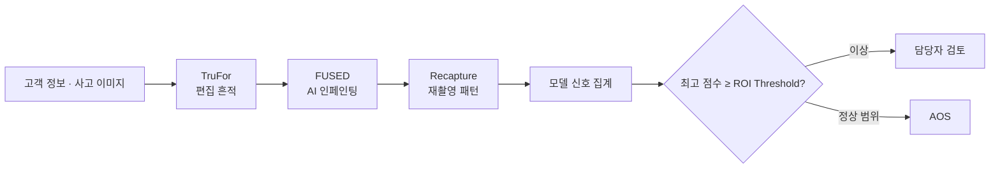

<div align="center">

# ClaimGuard Vision

### 자동차보험 사고 이미지 위·변조 분석 및 심사 지원 시스템


사고 사진의 **일반 편집**, **AI 인페인팅**, **화면 재촬영** 흔적을 분석하고  
보험사 담당자가 우선 검토할 청구건과 판단 근거를 제공합니다.

</div>

> ClaimGuard의 결과는 보험사기 확정 판정이 아닙니다. 최종 판단은 원본과 추가 증빙을 확인한 담당자가 수행해야 합니다.

## 주요 기능

- 여러 사고 이미지 일괄 접수 및 순차 GPU 분석
- TruFor · FUSED · Recapture 모델별 점수와 실행 상태 제공
- FUSED 의심 영역 Heatmap과 원본 비교
- 모델별 최고 위험 점수와 ROI 임계값 기반 검토 분기
- 청구건 저장, 검색, 정렬, 상세 증거 확인, 승인·반송
- 실제 판정 표본을 활용한 ROI 임계값 최적화
- 분석 당시 설정과 모델 출처를 포함한 JSON 결과 보존

## 분석 흐름



GPU 충돌을 방지하기 위해 모델은 `TruFor → FUSED → Recapture` 순서로 실행됩니다. 하나라도 실패하면 통합 점수와 판정을 만들지 않고 `INCOMPLETE`로 표시합니다.

## 빠른 실행

### Windows PowerShell

```powershell
Set-ExecutionPolicy -Scope Process Bypass
./scripts/setup_windows.ps1
./scripts/run_windows.ps1
```

실행 후 Streamlit 주소(기본 `http://localhost:8501`)를 엽니다.

> 앱 실행 환경과 별도로, 실제 GPU 추론에는 CUDA 및 모델별 독립 Python 환경이 필요합니다. 아래 모델 구성과 환경 변수를 확인하세요.

### Linux · WSL

```bash
python -m venv .venv
source .venv/bin/activate
pip install -r app/requirements.txt
.venv/bin/python -m streamlit run app/streamlit_app.py
```

<details>
<summary><b>실제 모델 환경 준비 (WSL 권장)</b></summary>

```bash
conda env create -p .venvs/trufor -f vendor/trufor/TruFor_train_test/trufor_conda.yaml

python3.12 -m venv .venvs/fused
.venvs/fused/bin/pip install -e vendor/fused

python3.11 -m venv .venvs/recapture
.venvs/recapture/bin/pip install -r models/recapture/requirements.txt \
  --extra-index-url https://download.pytorch.org/whl/cu126
```

가상환경별 의존성은 `app/requirements.txt`와 `models/<model>/requirements*.txt`를 참조하세요. TruFor 공식 환경은 `vendor/trufor/TruFor_train_test/trufor_conda.yaml`을 기준으로 구성합니다.

각 환경의 Python 경로는 아래 환경 변수로 앱에 연결합니다.

</details>

## 모델 가중치

모델 가중치와 외부 백본 캐시는 GitHub 저장소에 포함하지 않습니다. 아래 공식 배포처에서 내려받아 모두 `weights/` 아래에 배치합니다.

### 공식 원본 가중치와 백본

| 용도 | 공식 배포처 | 프로젝트 내 배치 경로 |
|:---|:---|:---|
| **TruFor 원본 체크포인트** | [GRIP 공식 TruFor 가중치](https://www.grip.unina.it/download/prog/TruFor/TruFor_weights.zip) | `weights/trufor/trufor.pth.tar` |
| **TruFor 초기 백본** | [GRIP TruFor 공식 저장소](https://github.com/grip-unina/TruFor/tree/main/TruFor_train_test/pretrained_models) | `weights/trufor/backbone/mit_b2.pth`, `weights/trufor/backbone/noiseprint++.th` |
| **FUSED 원본 체크포인트** | [FUSED 공식 Hugging Face](https://huggingface.co/aonuzhdin/FUSED) | `weights/fused/fused_opensdi.pth` |
| **FUSED ConvNeXt 백본** | `scripts/setup_fused_wsl.sh`가 timm/Hugging Face에서 자동 준비 | `weights/fused/backbone/huggingface/` |
| **Recapture DINOv2 백본** | [Meta DINOv2 with Registers Base](https://huggingface.co/facebook/dinov2-with-registers-base) | `weights/recapture/backbone/dinov2-with-registers-base/` |
| **Recapture detector** | [UserPollo Moiré Pattern Detector](https://huggingface.co/UserPollo/moire-pattern-detector) | `weights/recapture/` |

최종 디렉터리 구조는 다음과 같습니다.

```text
weights/
├── trufor/
│   ├── backbone/
│   │   ├── mit_b2.pth
│   │   └── noiseprint++.th
│   ├── trufor.pth.tar
│   └── finetuned/
│       ├── best.pth
│       └── history.json
├── fused/
│   ├── backbone/huggingface/
│   ├── fused_opensdi.pth
│   └── finetuned/
│       ├── best.pth
│       └── history.json
└── recapture/
    ├── backbone/dinov2-with-registers-base/
    │   ├── config.json
    │   └── model.safetensors
    ├── best_screen_detector_backbone.pt
    ├── best_screen_detector_mlp.pt
    └── classes.json
```

FUSED 환경과 ConvNeXt 캐시는 다음 스크립트로 준비할 수 있습니다. 원본 FUSED 체크포인트는 이어서 공식 다운로드 스크립트로 받습니다.

```bash
bash scripts/setup_fused_wsl.sh
.venvs/fused/bin/python vendor/fused/scripts/download_weight.py fused_opensdi.pth
```

Recapture 파일은 Hugging Face CLI로 받을 수 있습니다.

```bash
huggingface-cli download facebook/dinov2-with-registers-base \
  --local-dir weights/recapture/backbone/dinov2-with-registers-base

huggingface-cli download UserPollo/moire-pattern-detector \
  --local-dir weights/recapture
```

> 각 공식 배포처의 라이선스와 이용 조건을 확인한 뒤 사용하세요.

### 파인튜닝 가중치

ClaimGuard에서 학습한 TruFor와 FUSED의 최종 산출물은 각각 `finetuned/best.pth`와 `finetuned/history.json`입니다. 파인튜닝 가중치는 아래 학습 코드로 직접 만들거나, 필요한 경우 **저장소 관리자에게 문의해 주세요.**

앱은 기본적으로 파인튜닝 체크포인트를 사용합니다. 공식 원본으로 실행하려면 다음과 같이 경로를 지정합니다.

```bash
export CG_TRUFOR_CHECKPOINT="$PWD/weights/trufor/trufor.pth.tar"
export CG_FUSED_CHECKPOINT="$PWD/weights/fused/fused_opensdi.pth"
```

가중치와 백본 준비 상태를 확인합니다.

```bash
.venv/bin/python scripts/check_weights.py
```

모델별 라이브러리 충돌을 피하기 위해 각 모델은 별도 환경과 subprocess로 실행됩니다. UI는 `CG_STRICT_MODE=1`을 사용하므로 공식 모델이 아닌 폴백 결과는 정상 분석으로 인정하지 않습니다.

<details>
<summary><b>모델 환경 변수 보기</b></summary>

```bash
export CG_TRUFOR_PYTHON="$PWD/.venvs/trufor/bin/python"
export CG_FUSED_PYTHON="$PWD/.venvs/fused/bin/python"
export CG_RECAPTURE_PYTHON="$PWD/.venvs/recapture/bin/python"
export CG_TRUFOR_CHECKPOINT="$PWD/weights/trufor/finetuned/best.pth"
export CG_FUSED_CHECKPOINT="$PWD/weights/fused/finetuned/best.pth"
```

</details>

## 판정 기준

기본값은 [`config/runtime.json`](config/runtime.json)에서 관리합니다.

| 항목 | 기본값 |
|:---|---:|
| ROI 임계값 | 0.63 |
| 이미지 제한 | 최대 20장 |
| 파일 제한 | 이미지당 20MB · 전체 100MB |
| 모델 제한 시간 | 180초 |

최종 검토 분기는 완료된 세 모델 중 **가장 높은 위험 점수**를 사용합니다.

```text
max(TruFor, FUSED, Recapture) ≥ ROI threshold  →  HUMAN_REVIEW
max(TruFor, FUSED, Recapture) < ROI threshold  →  AOS
```

보험사 직원 화면에서는 완료된 청구건과 사후 확정 라벨을 바탕으로 비용이 가장 낮은 ROI 임계값을 탐색할 수 있습니다. 새 기준은 이후 분석부터 적용되며 기존 결과에는 분석 당시 임계값이 유지됩니다.

## 데이터 저장

- 정규화 이미지, 모델 산출물, 결과 JSON: `data/runtime/ui/<job-id>/`
- 청구 목록과 표시용 이미지·Heatmap: 브라우저 IndexedDB
- 모델 공통 입출력 계약: `contracts/model_io_schema.json`

브라우저 청구 목록은 접속 주소의 프로토콜·호스트·포트별로 분리됩니다. 예를 들어 `localhost:8501`과 다른 포트로 실행하면 서로 다른 목록이 보일 수 있지만, 서버 산출물은 위 런타임 디렉터리에 그대로 남습니다.

JPEG와 PNG를 지원하며, EXIF 방향을 보정한 RGB PNG로 정규화해 모델 입력과 Heatmap 위치를 맞춥니다.

## 프로젝트 구조

```text
app/          Streamlit 진입점과 UI 연결
backend/      분석 작업, 모델 게이트웨이, 점수 결합, 판정
dist/         브라우저 UI
models/       모델별 실행 진입점과 adapter
vendor/       TruFor·FUSED 원본 학습/추론 코드
training/     학습 보조 코드 및 FUSED 학습 진입점
weights/      원본·파인튜닝 가중치와 외부 백본 캐시
runs/         학습 중간 산출물과 로그
contracts/    공통 JSON 입출력 스키마
config/       런타임 설정
scripts/      설치, 실행, 학습, 점검 스크립트
tests/        백엔드 및 UI 회귀 테스트
```

## 파인튜닝

FUSED는 30 epochs를 학습합니다. TruFor는 Phase 2와 Phase 3을 각각 30 epochs씩 학습합니다. 두 모델의 배포 산출물은 `best.pth`와 `history.json`으로 통일되어 있으며 `latest.pth`는 만들지 않습니다.

### FUSED

WSL과 NVIDIA CUDA 환경에서 데이터 준비, 사전 점검, 30 epochs 학습, 최종 가중치 배포를 한 번에 실행합니다.

```bash
bash scripts/fused_wsl_all_in_one.sh
```

512×512 입력을 사용하며 데이터 무결성, 누수, 빈 마스크, GPU 메모리·온도와 디스크 공간을 점검합니다. 학습 로그와 중간 산출물은 `runs/fused_claimguard_30ep/`, 최종 배포 파일은 `weights/fused/finetuned/`에 저장됩니다.

### TruFor

공식 학습 코드는 localization network(Phase 2)와 detection/confidence network(Phase 3)로 구성됩니다. 두 단계 모두 `END_EPOCH=30`을 사용합니다.

```bash
cd vendor/trufor/TruFor_train_test

# Phase 2: ../../../runs/trufor/trufor_ph2/best.pth 생성
python train.py -exp trufor_ph2

# Phase 3: Phase 2의 best.pth를 명시적으로 연결
python train.py -exp trufor_ph3 \
  TRAIN.PRETRAINING ../../../runs/trufor/trufor_ph2/best.pth
```

학습 전 `project_config.py`의 데이터셋 경로를 실제 위치로 설정해야 합니다. Phase 3 완료 후 최종 `best.pth`와 `history.json`은 `weights/trufor/finetuned/`에도 자동 배포됩니다.

## 검증

Linux · WSL:

```bash
.venv/bin/python scripts/check_weights.py
.venv/bin/python scripts/smoke_test.py
.venv/bin/python -m unittest discover -s tests -v
```

Windows PowerShell:

```powershell
./.venv/Scripts/python.exe scripts/check_weights.py
./.venv/Scripts/python.exe scripts/smoke_test.py
./.venv/Scripts/python.exe -m unittest discover -s tests -v
```

실제 모델 연결을 폴백 없이 확인하려면:

```bash
.venv/bin/python scripts/smoke_test_ui.py --image /path/to/photo.jpg
```
## 문서

- [모델 입출력 계약](contracts/model_io_schema.json)
- [런타임 설정](config/runtime.json)

<div align="center">
  <sub>ClaimGuard Vision · Evidence-first claims review</sub>
</div>
